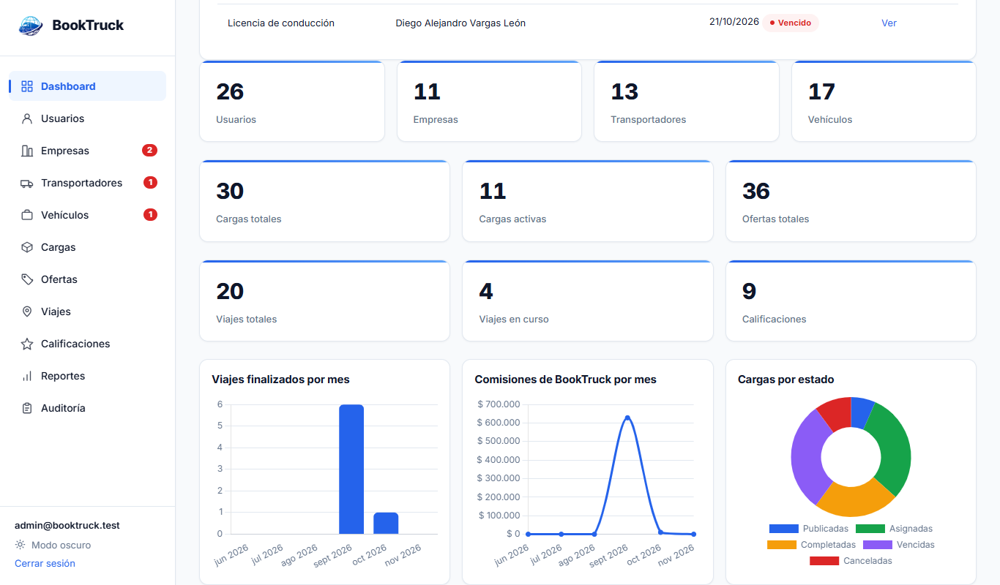
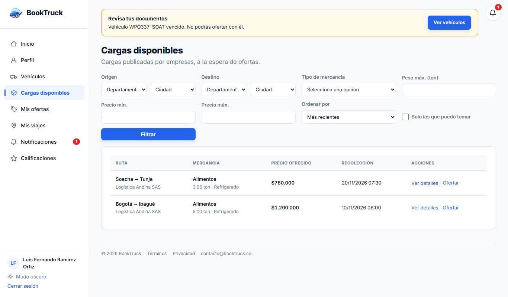
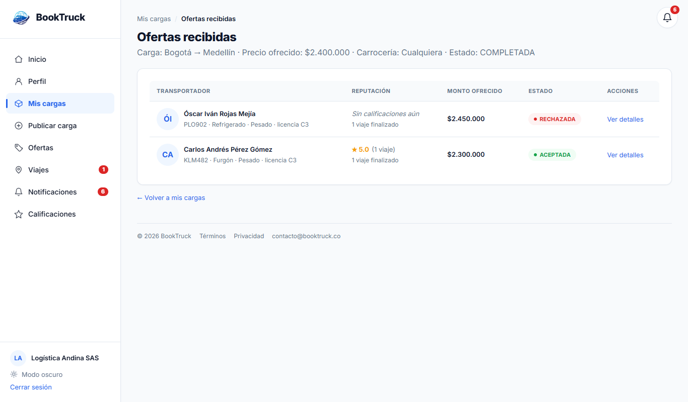
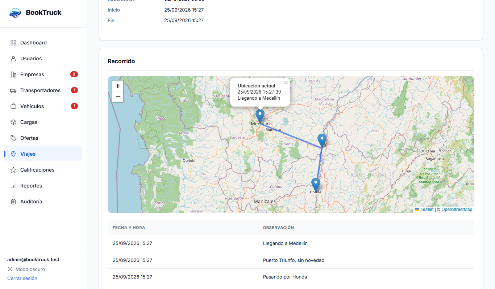
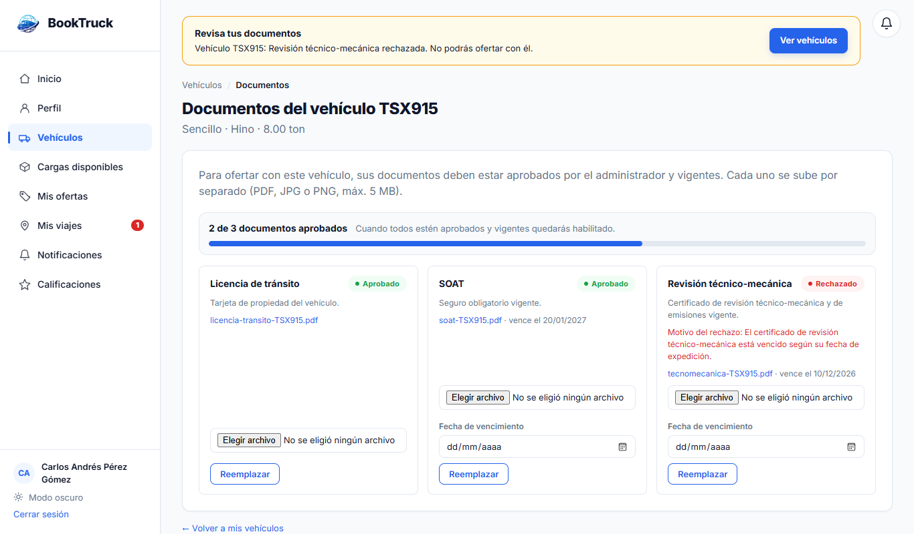
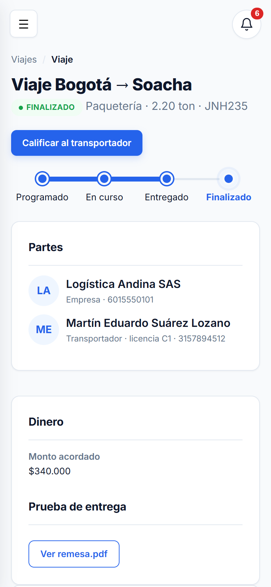

# BookTruck

Proyecto que desarrollé en mi formación como Tecnólogo en Análisis y Desarrollo de Software (ADSO) en el SENA.

BookTruck es una plataforma web para conectar empresas que necesitan transportar mercancía con transportadores de carga en Colombia. La empresa publica la carga, los transportadores que tienen sus documentos al día envían ofertas, la empresa escoge una y desde ahí se hace el seguimiento del viaje hasta la entrega.



## Qué se puede hacer

**Empresa**
- Publicar cargas indicando origen, destino, peso, tipo de carrocería que necesita y fecha de recolección.
- Ver las ofertas que le llegan, con la calificación y el historial de cada transportador.
- Aceptar una oferta, seguir el viaje en el mapa, revisar la prueba de entrega y calificar al transportador.

**Transportador**
- Registrar sus vehículos y subir los documentos (licencia de tránsito, SOAT, técnico-mecánica).
- Buscar cargas y filtrar solo las que puede llevar con sus vehículos.
- Ofertar, iniciar el viaje, registrar su ubicación y marcar la entrega subiendo la remesa.

**Administrador**
- Revisar los documentos de empresas, transportadores y vehículos y aprobarlos o rechazarlos.
- Ver indicadores, gráficas, reportes por fechas y un registro de las acciones de los administradores.
- Gestionar usuarios, cargas, ofertas, viajes y calificaciones.

## Algunas reglas del negocio

- Nadie puede publicar ni ofertar hasta que el administrador apruebe sus documentos. Si un documento se vence, se bloquea de nuevo (se avisa 30 días antes).
- La licencia del transportador tiene que corresponder al peso bruto del vehículo: C1 hasta 3.500 kg, C2 hasta 10.000 kg y C3 para articulados o vehículos más pesados.
- Si una carga pide carrocería refrigerada, solo pueden ofertar vehículos refrigerados.
- Si llega la fecha de recolección y nadie tomó la carga, queda vencida automáticamente.
- La plataforma cobra una comisión simulada del 3 % que se descuenta al transportador cuando se confirma la entrega.

## Capturas

Cargas disponibles para un transportador:



Ofertas que recibe una empresa:



Recorrido de un viaje en el mapa:



Documentos de un vehículo:



Vista en celular:



## Tecnologías

- Java 17 y Spring Boot (Spring MVC, Spring Data JPA, Spring Security)
- Thymeleaf, HTML, CSS y JavaScript
- MariaDB / MySQL (XAMPP)
- Chart.js para las gráficas y Leaflet con OpenStreetMap para los mapas
- JUnit y Mockito para las pruebas

## Cómo ejecutarlo

Se necesita Java 17 o superior y MySQL o MariaDB (yo uso XAMPP).

1. Clonar el repositorio:
   ```bash
   git clone https://github.com/Msv-prog/booktruck.git
   ```
2. Con MySQL encendido, crear la base de datos y el usuario administrador:
   ```bash
   mysql -u root < database/booktruck_db.sql
   mysql -u root < database/admin_inicial.sql
   ```
3. Si la base de datos tiene otro usuario o contraseña, cambiarlos en `src/main/resources/application.properties`.
4. Ejecutar la aplicación:
   ```bash
   mvnw spring-boot:run
   ```
5. Entrar a http://localhost:8080 con el administrador `admin@booktruck.test` y la contraseña `Test1234!`. Las empresas y transportadores se registran desde la página principal.

Para correr las pruebas de las reglas del negocio:

```bash
mvnw test -Dtest=CategoriaLicenciaTest,CargaYViajeTest,VerificacionTest,ComisionTest
```

En la carpeta `docs` está el [manual de usuario](docs/manual-usuario.md).

## Autor

Myck, Tecnólogo en ADSO del SENA.
GitHub: [Msv-prog](https://github.com/Msv-prog)

*Proyecto académico: los pagos y la comisión son simulados.*
